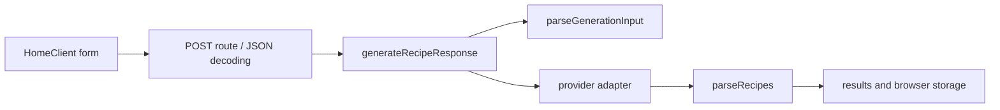

# Map the real request and persistence paths

Begin at [HomeClient](../app/HomeClient.tsx). Its state contains ingredients, a time limit and preferences. Submitting serializes those values to `/api/recipes`. The UI disables the visible submit control for too few ingredients, but that check cannot establish a server invariant: a caller can send HTTP directly, a saved client can be old, and browser state can be malformed.

The [route adapter](../app/api/recipes/route.ts) retains the existing process-local rate limiter and JSON decoding. It delegates domain-shaped input and provider results to [generation orchestration](../lib/generation.ts). The orchestration calls [validation](../lib/validation.ts), invokes the supplied provider function only after the request is accepted, and validates its output before returning a success body. The actual SDK adapter stays in the route; tests inject a deterministic function at this boundary.

Follow the successful browser path separately. HomeClient builds a generation-result record, calls [saveToHistory](../lib/storage.ts), writes the current result to session storage, and navigates to the results page. History and favorites use different local-storage keys. They are local CRUD collections, not server-authoritative resources. Parsing saved records is still important because local storage persists across software versions and can contain values this version did not write.

The [type declarations](../lib/types.ts) describe trusted objects inside the program. They do not validate JSON. The new parsing functions turn unknown values into that trusted representation while dropping unrelated fields. Read each returned object literal and identify which fields are normalized, constrained or defaulted.

For a code-reading exercise, draw two columns labeled transport and policy. Place request JSON decoding, HTTP status creation, provider retry count, ingredient bounds and storage recovery in one column each. Explain any choice that could reasonably belong in both. Then locate the [tests](../tests/boundaries.test.mjs) that prove invalid requests do not cross the provider boundary. There is no database transaction to trace here; a later SQL exercise should explicitly add that new responsibility instead of pretending it already exists.
